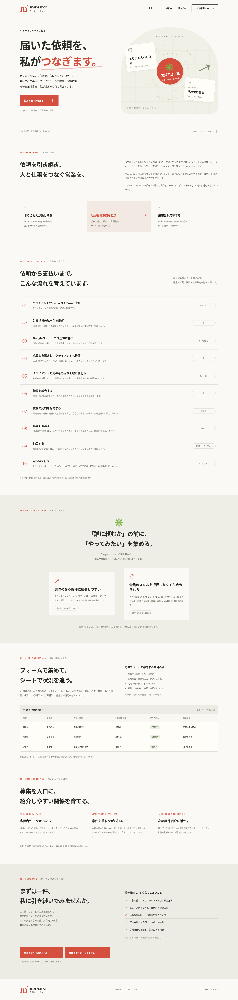
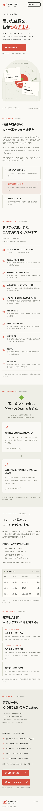
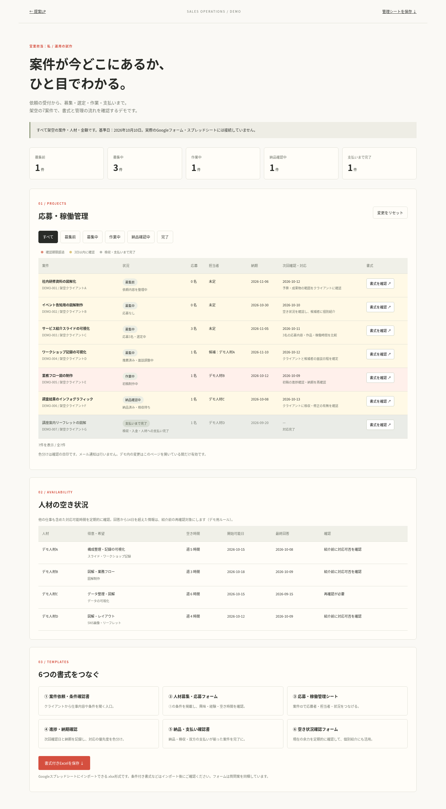
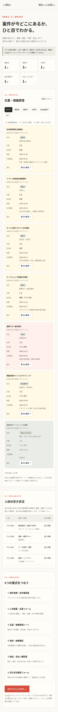

# marie.mon — 仕事を、つなぐ。

まりえもんに届いた依頼を営業担当の「私」に引き継ぎ、Googleフォームで講座生を募集し、選定・推薦・面談調整・結果報告へつなぐ具体的な営業方法の提案LPです。依頼から支払いまでの10段階、Googleフォームとスプレッドシートの活用理由、応募者がいない場合の個別紹介を説明しています。Googleフォームやスプレッドシートとの実際の連携はまだ実装していません。

## ローカル起動

依存パッケージのインストールは不要です。Python 3で配信できます。

```sh
cd /workspace/marie.mon
python3 -m http.server 3000 --bind 0.0.0.0
```

`index.html`、`style.css`、`script.js` がページ本体です。相談メモはブラウザー上で作成し、テキストファイルとして保存します。外部サービスへの送信やフォーム受付機能はありません。制度・役割・報酬は今後相談して決める前提です。

## 見た目を確認する

### PC版



### スマートフォン版



## 自分のパソコンで開く

GitHubの「Code」→「Download ZIP」でファイル一式をダウンロードし、ZIPを解凍して `index.html` をChromeやSafariで開いてください。サーバーを起動しなくても、表示と相談メモの保存が使えます。

リポジトリを非公開のまま使えます。GitHub PagesによるWeb公開は設定していません。

## 営業運用デモ

[ブラウザーで動くデモのファイル](demo/index.html) と [Googleスプレッドシートにインポートできる管理シート](demo/営業運用デモ.xlsx) を追加しました。GitHubではHTMLはコード表示になるため、「Code」→「Download ZIP」で一式を保存し、解凍後の `demo/index.html` をブラウザーで開いてください。

募集前1件、募集中3件（応募なし／応募3名・選定中／推薦済み・面談調整中）、作業中1件、納品確認中1件、支払いまで完了1件の、すべて架空のデータです。デモの基準日は2026年10月10日で固定しています。

各案件の「書式を確認」から6種類の書式案を確認できます。デモ応募、進捗・空き状況の更新、完了条件が揃った際のグレーアウトを試せます。変更はページ内のみで、実際のGoogleフォームへの送信、管理シートの更新、メール通知、請求・送金は行いません。個人情報を入力しないでください。Excelファイルは初期の架空データを収録した固定の書式です。

### 運用デモの画面




